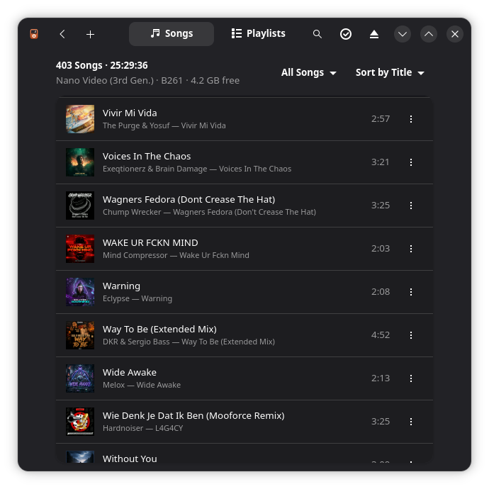
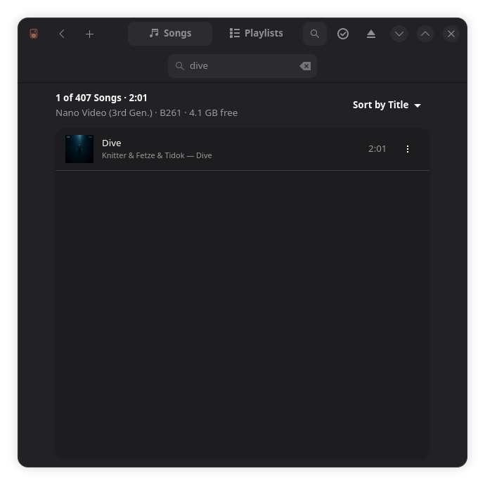

#  Oxipod

Put music on your old iPod from Linux.

I wanted to use my old iPod nano again, but there's no good way to get music
onto it from Linux anymore, so I made this. You plug in your iPod, drop some
music on the window, and that's it.

<p align="center">
  
  
</p>

## What it does

- Add songs or whole album folders by dragging them onto the window (or with
  the + button)
- Converts stuff the iPod can't play (FLAC, Opus, Ogg, WAV, WebM, ...) to MP3
  on the fly. MP3 and AAC/ALAC files are copied as they are
- Copies cover art, either from the file or from a `cover.jpg` in the album
  folder. You can also pick a cover yourself for a song, a whole album or a
  bunch of selected songs, and a filter shows the songs that don't have one
- Search the songs on the iPod (Ctrl+F) and sort them by title, artist, album
  or when you added them. The list stays quick even with thousands of songs
- Finds songs that are on the iPod twice and ticks the extra copies, so you
  can delete them in one go
- Playlists: create them, add songs, remove songs. Tick a few songs on a
  playlist's page to take them off it or copy them in one go
- Delete songs from the iPod, or select a bunch and delete them or add them
  to a playlist in one go
- Fix the title, artist, album and album artist of a song, or of a bunch of
  selected songs at once. This changes what the iPod shows, not your files
- Copy songs back to your computer, all in one folder with names like
  `Artist - Title.mp3` or in folders by artist and album. One at a time, a
  whole selection, or everything on the iPod. Handy as a backup of your music
- Offers to back up the iPod's database before you open it, and puts a backup
  back if something went wrong
- Sets newer iPods (the classic, the nano from the 3rd generation on) up by
  itself the first time you open them, no terminal needed
- Rename the iPod
- Cleans up leftover files from syncs that got interrupted, and songs that are
  in the list but whose files are gone
- Ejects the iPod when you're done

## Installing

Add Oxipod's own Flatpak repository once and install from it. After that,
updates show up in your software center and with `flatpak update`:

```
flatpak remote-add --user --if-not-exists oxipod https://nyxn3t.github.io/Oxipod/oxipod.flatpakrepo
flatpak install --user oxipod io.github.nyxn3t.Oxipod
```

Or open [oxipod.flatpakref](https://nyxn3t.github.io/Oxipod/oxipod.flatpakref)
with your software center. It pulls in the GNOME runtime from Flathub if you
don't have it yet.

This isn't Flathub, so adding the repository means you trust me to ship updates.
They're signed with this key, which Flatpak checks for you:
`8990 48DA 42D4 FA50 7EC6 F01F A9A4 E497 D0B1 7C45`.

If you'd rather not add a repository, grab the `.flatpak` file from the
[latest release](https://github.com/nyxn3t/Oxipod/releases/latest) and install
it:

```
flatpak install --user oxipod-*.flatpak
```

That one doesn't update by itself: check the releases page now and then. If you
installed it that way and want updates, remove it first and use the repository
(your settings stay):

```
flatpak uninstall --user io.github.nyxn3t.Oxipod
```

## Which iPods work

Oxipod uses [libgpod](https://sourceforge.net/projects/gtkpod/) to talk to the
iPod, so it should work with the models libgpod supports: the iPod classic,
the mini and the nano up to the 4th generation.

So far I've only tested it with an iPod nano 3rd gen. If you try it with
something else, let me know how it goes: reply in
[Which iPod do you have, and did it work?](https://github.com/nyxn3t/Oxipod/discussions/1),
or open an issue (there's a form for it). The About window (in the main menu)
has a Troubleshooting section with the details to paste.

The touchscreen nanos (6th and 7th gen), the iPod touch and iPhones don't
work.

### First time setup on newer models

The nano 3rd gen and newer (and the iPod classic) need a description of
themselves, with their model and their unique ID, before Oxipod can write a
database they accept. Without it the iPod just looks empty, however many songs
you add. Oxipod notices when an iPod is missing it and offers to fix that when
you open the iPod. Your system asks for your password to allow it, and it
happens once per iPod.

<details>
<summary>If that doesn't work</summary>

Oxipod shows you the command to run yourself, with your drive filled in. It's
the one libgpod comes with, run once with the iPod mounted:

```
sudo ipod-read-sysinfo-extended /dev/sdX /run/media/$USER/YOUR_IPOD
```

(replace `/dev/sdX` with your iPod's drive, `lsblk` shows it). It only adds a
small file to the iPod.

</details>

### iPods formatted on a Mac

iPods that were formatted on a Mac (HFS+) are mounted read-only on Linux for as
long as their journal is turned on, which is how a Mac sets them up. Oxipod
notices: a lock shows next to the iPod in the list, a message at the top of its
page says why, and everything that would change the iPod is switched off.
Looking at the songs, copying them off the iPod and backing it up still work.

To be able to add songs, turn the journal off on a Mac (in Terminal:
`diskutil disableJournal /Volumes/NAME_OF_THE_IPOD`), or reformat the iPod as
FAT32, which erases everything on it. An iPod that was unplugged without being
ejected can be read-only too: plug it in again, and let a computer check the
disk if it stays that way.

## Building

You need Rust, GTK 4, libadwaita, libgpod, clang (for the libgpod bindings)
and ffmpeg. On Fedora:

```
sudo dnf install rustup gtk4-devel libadwaita-devel libgpod-devel clang-devel ffmpeg-free
rustup-init
```

Then:

```
cargo run --release
```

There's also a Flatpak manifest in `flatpak/` that builds everything,
including libgpod and a small ffmpeg:

```
flatpak run org.flatpak.Builder --user --install --force-clean flatpak/build flatpak/io.github.nyxn3t.Oxipod.yml
```

## Before you use it

Oxipod has worked fine on mine, but it's a young app writing to a database
format Apple never documented, so better safe than sorry. When you open an
iPod, Oxipod offers to back up its database: the song list and the covers,
about 100 MB on a nano, not the music. Say yes. You can tick "Don't ask
again", and the main menu has a switch to turn the question back on. The ⋮
menu of an iPod also has "Back Up…" for whenever you want one, and "Copy All
to Computer…" to save the music itself.

To put a backup back, use "Restore from Backup…" in the same menu and pick the
backup's folder. Oxipod checks that the backup is from this iPod, saves what is
on the iPod right now in a folder you choose (so you can undo the restore), and
then copies the song list and the covers back. Songs you added after the backup
disappear from the list, and Oxipod offers to clean up their files. Songs you
deleted since then show up in the list again without their files, and Oxipod
offers to take them out of the list.

You can also do it by hand: copy the `iPod_Control` folder from the backup onto
the iPod. Every backup has a README.txt that says how.

## License

GPL-3.0-or-later, see [LICENSE](LICENSE).
